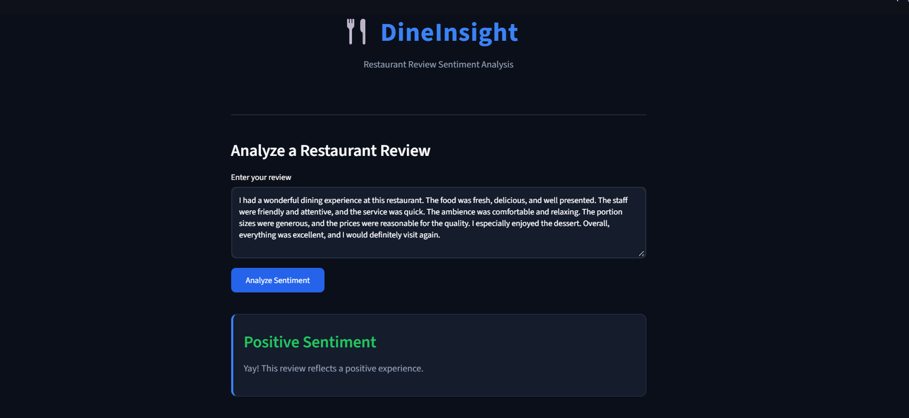
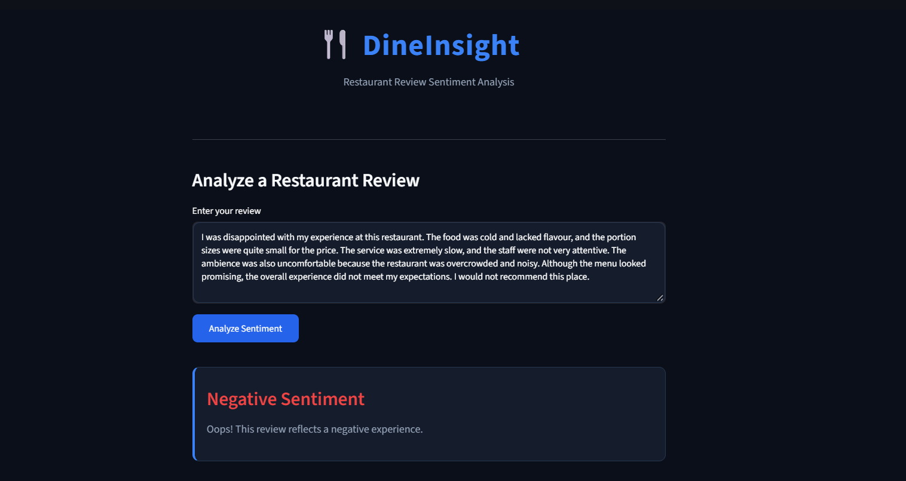

# DineInsight – Restaurant Review Sentiment Analysis

## Project Overview

DineInsight is an NLP-based application that analyzes restaurant reviews and classifies them into positive or negative sentiments using Machine Learning techniques.

The application allows users to enter a restaurant review and receive an instant sentiment prediction through an interactive Streamlit interface.

## Application Preview




## Objectives

- Analyze restaurant reviews to identify customer opinions.
- Apply Natural Language Processing techniques to process textual data.
- Convert text into numerical features using TF-IDF vectorization.
- Develop a Machine Learning model for sentiment classification.
- Build an interactive application for sentiment prediction.

## Technologies Used

- Python
- NLTK
- Scikit-learn
- TF-IDF Vectorization
- Streamlit
- HTML and CSS

## Key Features

- Text preprocessing using tokenization, stopword removal, and stemming.
- TF-IDF-based feature extraction.
- Positive and negative sentiment classification.
- Interactive review input.

## Project Structure

```text
DineInsight/
├── data/
│   └── output.csv
├── models/
│   └── nlp_model.pkl
├── app.py
├── data.ipynb
├── requirements.txt
├── .gitignore
└── README.md
```

## How to Run

1. Clone the repository.
2. Install the dependencies:

   `pip install -r requirements.txt`

3. Run the application:

   `streamlit run app.py`

## Learning Outcomes

This project provided hands-on experience with text preprocessing, feature extraction, Machine Learning-based text classification, model serialization, and integrating a trained model into an interactive application using Streamlit.